<!-- ========================================================= -->
<!--              ADAPTIVE CYBER HERO BANNER                   -->
<!-- ========================================================= -->

<picture>
  <source media="(prefers-color-scheme: dark)" srcset="./dark.svg" />
  <source media="(prefers-color-scheme: light)" srcset="./light.svg" />
  
</picture>

  

<!-- Animated Typing SVG (Matched to Electric Cyan & Royal Blue Palette) -->

  <em>Crafting minimal, high-impact digital experiences from West Bengal, India.</em>

<!-- Curved Pill CTA & Social Buttons -->

  
  
  
  

<!-- Status & Profile Visitor Pill Badges -->

  
  

<!-- Quick Navigation Pill Bar -->

  
  
  
  
  

<!-- Cyan Neon Divider -->

<!-- ========================================================= -->
<!--                         ABOUT ME                          -->
<!-- ========================================================= -->
## 💠 About Me

I am **Sonai Das**, a multidisciplinary **Web Designer, Frontend Developer, and Data Analyst** based in West Bengal, India[cite: 3]. I operate at the intersection of visual design, interactive frontend engineering, and analytical problem-solving[cite: 3].

Whether architecting a responsive web interface, choreographing fluid web animations, or distilling complex datasets into actionable insights, my focus remains the same: **clarity, precision, and purposeful digital innovation**[cite: 3].

<strong>🔘 Click to Expand — Executive Profile Snapshot</strong>

 

| Parameter | Details |
| :--- | :--- |
| **📍 Base Location** | West Bengal, India[cite: 3] |
| **🎯 Core Focus** | Web Development, UI/UX Design, Data Analytics & Digital Innovation[cite: 3] |
| **💡 Design Philosophy** | Minimalism backed by data; aesthetics engineered for performance[cite: 3]. |
| **🟢 Availability** | Open for Freelance, Collaborations & Full-Time Roles[cite: 3] |
| **🌐 Live Portfolio** | [dassonai.netlify.app](https://dassonai.netlify.app/)[cite: 3] |
| **📫 Direct Inquiry** | [dassonai743425@gmail.com](mailto:dassonai743425@gmail.com)[cite: 3] |

 

<!-- ========================================================= -->
<!--                GITHUB STATISTICS DASHBOARD                -->
<!-- ========================================================= -->
## 📊 GitHub Analytics

<!-- Adaptive GitHub Stats & Top Languages -->
<a href="https://github.com/WebDeveloper-Sonai">
  <picture>
    <source media="(prefers-color-scheme: dark)" srcset="https://github-readme-stats.vercel.app/api?username=WebDeveloper-Sonai&show_icons=true&bg_color=0A1120&title_color=38BDF8&text_color=E2E8F0&icon_color=10B981&border_color=1E3A8A&border_radius=14&hide_border=false" />
    <source media="(prefers-color-scheme: light)" srcset="https://github-readme-stats.vercel.app/api?username=WebDeveloper-Sonai&show_icons=true&bg_color=F8FAFC&title_color=2563EB&text_color=1E293B&icon_color=10B981&border_color=93C5FD&border_radius=14&hide_border=false" />
    
  </picture>
</a>
<a href="https://github.com/WebDeveloper-Sonai">
  <picture>
    <source media="(prefers-color-scheme: dark)" srcset="https://github-readme-stats.vercel.app/api/top-langs/?username=WebDeveloper-Sonai&layout=compact&bg_color=0A1120&title_color=38BDF8&text_color=E2E8F0&border_color=1E3A8A&border_radius=14&hide_border=false" />
    <source media="(prefers-color-scheme: light)" srcset="https://github-readme-stats.vercel.app/api/top-langs/?username=WebDeveloper-Sonai&layout=compact&bg_color=F8FAFC&title_color=2563EB&text_color=1E293B&border_color=93C5FD&border_radius=14&hide_border=false" />
    
  </picture>
</a>

  

<!-- Adaptive GitHub Streak Stats -->
<a href="https://github.com/WebDeveloper-Sonai">
  <picture>
    <source media="(prefers-color-scheme: dark)" srcset="https://github-readme-streak-stats.herokuapp.com/?user=WebDeveloper-Sonai&background=0A1120&ring=38BDF8&fire=10B981&currStreakLabel=38BDF8&sideLabels=E2E8F0&currStreakNum=FFFFFF&sideNums=E2E8F0&dates=94A3B8&border=1E3A8A&border_radius=14" />
    <source media="(prefers-color-scheme: light)" srcset="https://github-readme-streak-stats.herokuapp.com/?user=WebDeveloper-Sonai&background=F8FAFC&ring=2563EB&fire=10B981&currStreakLabel=2563EB&sideLabels=1E293B&currStreakNum=0F172A&sideNums=1E293B&dates=64748B&border=93C5FD&border_radius=14" />
    
  </picture>
</a>

  

<!-- Adaptive Contribution Activity Graph -->
<a href="https://github.com/WebDeveloper-Sonai">
  <picture>
    <source media="(prefers-color-scheme: dark)" srcset="https://github-readme-activity-graph.vercel.app/graph?username=WebDeveloper-Sonai&bg_color=0A1120&color=38BDF8&line=38BDF8&point=10B981&area=true&area_color=1E3A8A&border_color=1E3A8A&radius=14&hide_border=false&custom_title=Contribution%20Activity" />
    <source media="(prefers-color-scheme: light)" srcset="https://github-readme-activity-graph.vercel.app/graph?username=WebDeveloper-Sonai&bg_color=F8FAFC&color=2563EB&line=2563EB&point=10B981&area=true&area_color=DBEAFE&border_color=93C5FD&radius=14&hide_border=false&custom_title=Contribution%20Activity" />
    
  </picture>
</a>

 

<strong>🏆 Click to Expand — GitHub Achievements & Milestones</strong>

 
<ul>
  <li><strong>Pull Shark & Quickdraw:</strong> Consistent open-source contributions and rapid issue resolution[cite: 3].</li>
  <li><strong>Milestone 1:</strong> Replace with a verified project launch or certification[cite: 3].</li>
  <li><strong>Milestone 2:</strong> Replace with a notable open-source contribution or client highlight[cite: 3].</li>
</ul>

 

<!-- ========================================================= -->
<!--                        WHAT I DO                          -->
<!-- ========================================================= -->
## ⚡ Core Capabilities

<table>
  <tr>
    <td width="33%" valign="top">
      <h4>🎨 Website Design</h4>
      
Designing modern, brand-aligned layouts with strong visual hierarchy and executive polish[cite: 3].

      
    </td>
    <td width="33%" valign="top">
      <h4>💻 Frontend Development</h4>
      
Translating concepts into clean, maintainable, and interactive web applications[cite: 3].

      
    </td>
    <td width="33%" valign="top">
      <h4>📱 Responsive Web Design</h4>
      
Ensuring seamless usability and fluid layouts across desktops, tablets, and mobile devices[cite: 3].

      
    </td>
  </tr>
  <tr>
    <td width="33%" valign="top">
      <h4>✨ UI/UX Design</h4>
      
Crafting intuitive user journeys, micro-interactions, and friction-free interfaces[cite: 3].

      
    </td>
    <td width="33%" valign="top">
      <h4>📊 Data Analysis</h4>
      
Interpreting structured data to uncover trends, support decisions, and drive measurable results[cite: 3].

      
    </td>
    <td width="33%" valign="top">
      <h4>🚀 Digital Services</h4>
      
Delivering end-to-end digital solutions tailored for individuals, creators, and businesses[cite: 3].

      
    </td>
  </tr>
</table>

 

<!-- ========================================================= -->
<!--                        TECH STACK                         -->
<!-- ========================================================= -->
## 🛠️ Tech Stack

<strong>🎨 Design & Creative Suite</strong>

  
  
  

<strong>🌐 Frontend & Web UI</strong>

  
  
  
  

<strong>⚙️ Backend & Runtime</strong>

  
  
  
  

<strong>🗄️ Databases</strong>

  
  
  

<strong>🔗 APIs & Integration</strong>

  

 

<!-- ========================================================= -->
<!--                     FEATURED PROJECTS                     -->
<!-- ========================================================= -->
## 🚀 Featured Projects

<table>
  <tr>
    <td width="50%" valign="top">
      <h3>🌐 Personal Portfolio Website</h3>
      
Flagship digital portfolio showcasing web design, interactive animations, and professional services with a refined modern aesthetic[cite: 3].

      

        
        
        
      

      

        
        
      

    </td>
    <td width="50%" valign="top">
      <h3>✨ YOUR_PROJECT_2_NAME</h3>
      
Brief, high-impact description of your interactive frontend or animation project, highlighting the problem solved and visual experience[cite: 3].

      

        
        
        
      

      

        
        
      

    </td>
  </tr>
  <tr>
    <td width="50%" valign="top">
      <h3>📊 YOUR_PROJECT_3_NAME</h3>
      
Brief description of a data analysis, dashboard, or responsive web project demonstrating structured thinking and clean UI[cite: 3].

      

        
        
        
      

      

        
        
      

    </td>
    <td width="50%" valign="top">
      <h3>🎨 YOUR_PROJECT_4_NAME</h3>
      
Brief description of a UI/UX redesign, landing page, or digital service showcase built for speed and responsiveness[cite: 3].

      

        
        
        
      

      

        
        
      

    </td>
  </tr>
</table>

 

<!-- ========================================================= -->
<!--                      LET'S CONNECT                        -->
<!-- ========================================================= -->
## 🌐 Let's Connect

Open to collaborations, freelance web design & development projects, and data analytics opportunities[cite: 3].

<!-- Curved Pill Contact Buttons -->

  
  

  
  
  
  

<!-- ========================================================= -->
<!--                          FOOTER                           -->
<!-- ========================================================= -->

 

  <em>"Design is not just what it looks like and feels like. Design is how it works."</em>[cite: 3]

  <strong>Designed & Built by Sonai Das</strong>[cite: 3]

<!-- Electric Cyan & Midnight Slate Footer Wave -->

